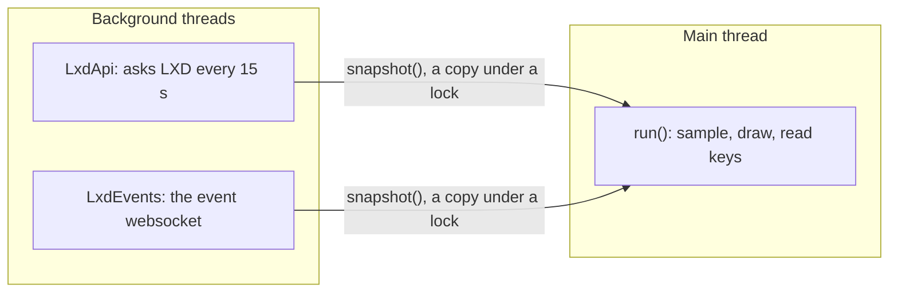
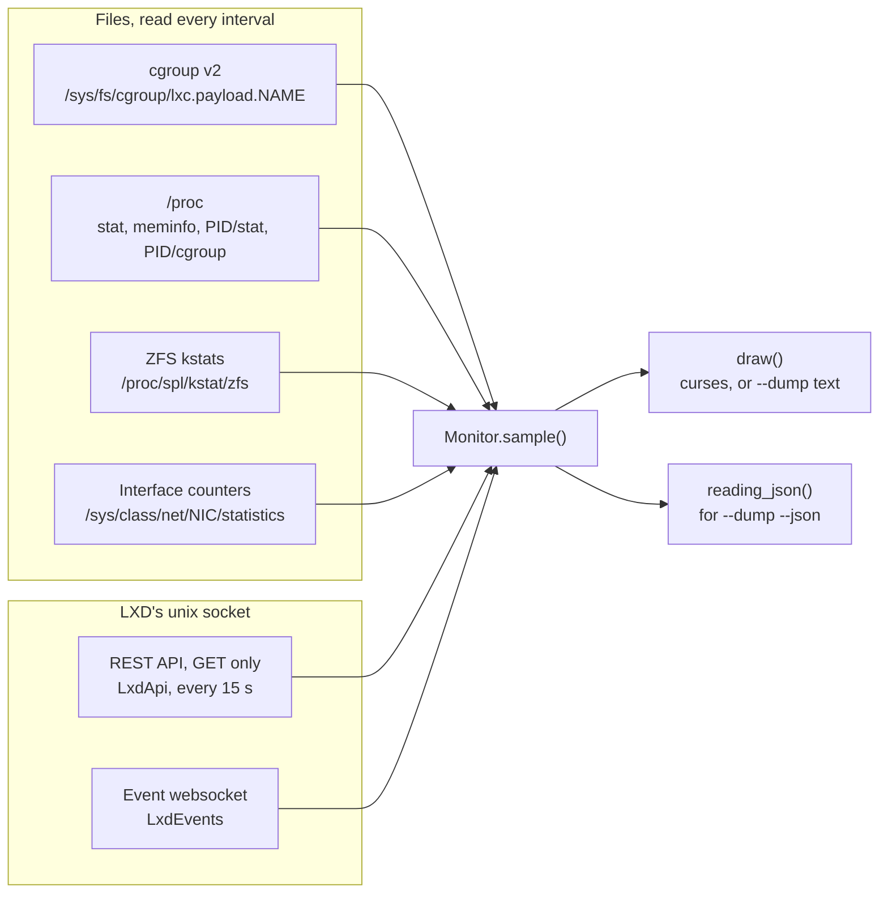
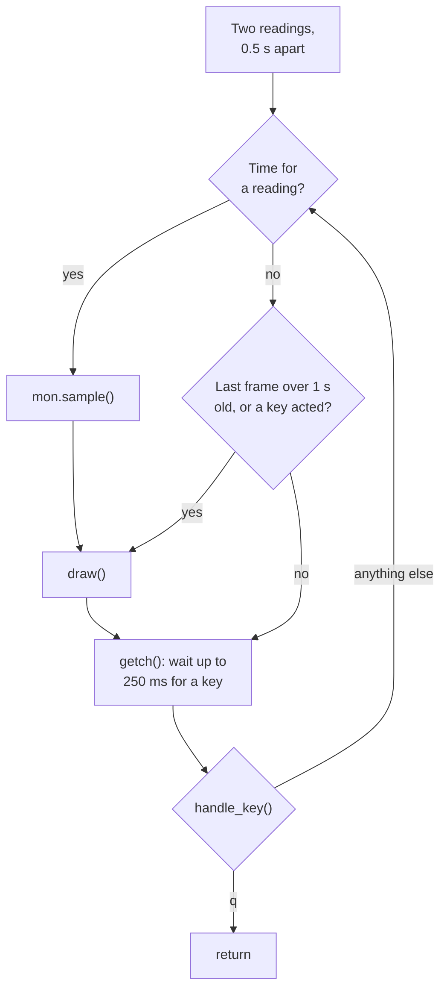
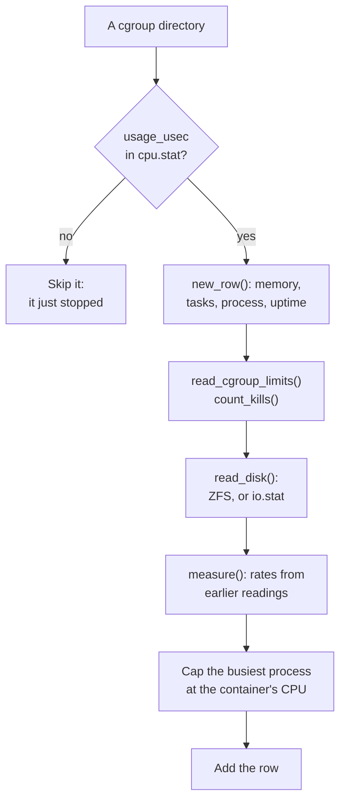
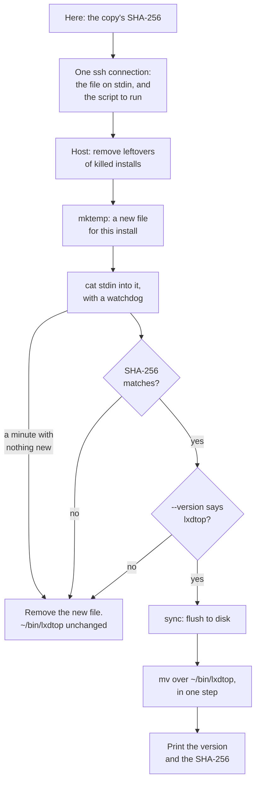

# A walkthrough of lxdtop

This page explains how lxdtop is put together and how it was built, for people reading the code together. It
follows the data: where each number comes from, how two readings become a rate, and how a frame reaches the screen.
It ends with a reading order and the design choices most worth arguing about.

Line numbers are for lxdtop 1.9.0, and each one links to the file at the `v1.9.0` tag, so the links keep showing
the code this page describes after the file changes. When this page was written, `lxdtop` and
`contrib/lxdtop-remote` on `main` were the same as in 1.9.0.

## Contents

1. [What lxdtop is, and the rules it keeps](#1-what-lxdtop-is-and-the-rules-it-keeps)
2. [Where the numbers come from](#2-where-the-numbers-come-from)
3. [The sampling loop and `rate()`, line by line](#3-the-sampling-loop-and-rate-line-by-line)
4. [Drawing the screen](#4-drawing-the-screen)
5. [Dumps: one frame as text, one reading as JSON](#5-dumps-one-frame-as-text-one-reading-as-json)
6. [contrib/lxdtop-remote](#6-contriblxdtop-remote)
7. [Tests and CI](#7-tests-and-ci)
8. [How it was built](#8-how-it-was-built)
9. [Reading it together](#9-reading-it-together)

## 1. What lxdtop is, and the rules it keeps

lxdtop shows a live view of one LXD host in a terminal: CPU, memory and network panels for the host, a graph of CPU
use by instance, a feed of LXD's events, and one table row per container or virtual machine. It runs on the host
itself, as a user in the `lxd` group or as root, and it only reads.

Five rules shape almost every line. [CONTRIBUTING.md](../CONTRIBUTING.md) and [CLAUDE.md](../CLAUDE.md) hold every
change to them.

- **One file, standard library only.** Installing lxdtop means copying one file, and reviewing it means reading one
  file. It imports 16 standard-library modules ([lines 42 to 57][L42-L57]): `argparse`, `base64`, `collections`,
  `curses`, `datetime`, `glob`, `http.client`, `json`, `locale`, `os`, `socket`, `threading`, `time`, `types`,
  `unicodedata` and `urllib.parse`. Each one is used.
- **Read-only.** lxdtop sends LXD only GET requests and the one request that opens the event stream. It opens files
  only for reading and starts no programs. [tests/test_readonly.py](../tests/test_readonly.py) reads lxdtop's syntax
  tree and fails if any of that changes.
- **The Linux console comes first.** The classic drawing uses 16 colors and only characters that Ubuntu's console
  font has: full block, medium and light shade, box drawing, and `■ ● · … ▲ ▼ ↑ ↓ °`. Frames that lxdtop 1.7.1 drew
  are kept in `tests/fixtures/frame-*.txt`, and the classic drawing must still match them cell for cell.
- **`--ascii` keeps working.** Every drawing character comes from one of two glyph tables, so plain ASCII is a swap
  of tables, not a second drawing.
- **Secrets stay off the screen.** `lxc exec` command lines show only with `--show-commands`, because they can hold
  passwords. The only keys lxdtop reads from an instance's config are a VM's `limits.cpu` and `limits.memory`.

It supports LXD 5.21 and 6 and needs cgroup v2 (Ubuntu 22.04 or later). CI tests it on Python 3.10, 3.12 and the
newest release.

### A map of the file

The file's sections start with comment lines such as `# --- Sampling ---`.

| Lines | Section | Main pieces |
|---|---|---|
| 1 to 227 | Settings, styles and glyphs | constants, `STYLES`, `GLYPHS_UNICODE`, `GLYPHS_ASCII`, `EVENT_LABELS` |
| 229 to 608 | Reading the kernel's counters | `read()` and the parsers, `rate()`, `ProcessTable` |
| 611 to 1015 | LXD's API and event stream | `UnixHTTPConnection`, `LxdApi`, `LxdEvents` |
| 1018 to 1276 | Sampling | `Monitor` |
| 1279 to 1613 | Drawing primitives | `Canvas`, `box()`, number formats, glyph pickers |
| 1616 to 2344 | Panels | a `draw_*()` for each panel, `fit_layout()`, `draw()` |
| 2347 to 2481 | The help screen and the detail view | `draw_help()`, `draw_detail()` |
| 2484 to 2638 | One reading as JSON | `reading_json()`, `instance_json()` |
| 2641 to 2962 | Running it | `curses_attrs()`, `pick_drawing()`, `KEYS`, `handle_key()`, `run()`, `main()` |

### Three threads



The screen never waits on LXD. Each background thread keeps its latest answer behind a `threading.Lock`, and
`Monitor.sample()` takes a copy of it (`LxdApi.snapshot()`, [line 865][L865], and `LxdEvents.snapshot()`,
[line 1008][L1008]). A slow or restarting LXD only makes its part of the screen older. The screen itself keeps
updating.

## 2. Where the numbers come from



The files are the kernel's own counters. LXD's API adds what only LXD knows: names, addresses, VMs, stopped
instances, snapshots and pool usage. Without the API (`--no-api`, or no access to the socket), lxdtop still shows
each running container by name, with its CPU, memory and disk.

### cgroup v2

Each running container has a cgroup directory, `/sys/fs/cgroup/lxc.payload.<name>` (`CGROUP_GLOB`,
[line 61][L61]), and its files count everything the container's processes do. `Monitor.sample_instances()`
([line 1136][L1136]) lists those directories every interval. A directory is how lxdtop knows a container is
running, with or without LXD's API.

| File | Read by | Becomes |
|---|---|---|
| `cpu.stat` (`usage_usec`) | `read_fields()`, [line 249][L249] | CPU, through `measure()` |
| `memory.current`, `memory.stat` | `read_int()`, `read_fields()` | MEM: current minus `inactive_file` |
| `pids.current` | `read_int()`, [line 241][L241] | TASKS |
| `io.stat` | `read_io_stat()`, [line 274][L274] | DISK R and W, when the disk isn't on ZFS |
| `cpu.max`, `cpuset.cpus.effective` | `read_cgroup_limits()`, [line 303][L303] | the CPU limit and THROTTLED |
| `memory.max`, `pids.max` | `read_cgroup_limits()` | MEM/LIMIT and PROCS/LIMIT |
| `cpu.pressure`, `memory.pressure`, `io.pressure` | `read_cgroup_limits()` | WAITING ("some avg10") |
| `memory.events` (`oom_kill`) | `Monitor.count_kills()`, [line 1226][L1226] | MEM KILLS |

MEM leaves out file cache the kernel can drop at any time, as `docker stats` does. Outside the default project,
LXD names the cgroup `<project>_<name>`, and `project_of()` and `name_of()` ([lines 508 and 514][L508-L516]) split
it. A VM has no container cgroup on the host: LXD runs it as a QEMU process, and lxdtop reads that process instead.

### /proc

- `/proc/stat`: `read_cpu_times()` ([line 385][L385]) gives busy and total time for the whole host and for each CPU
  thread, and `busy_pct()` ([line 401][L401]) turns two of them into a share.
- `/proc/meminfo`: `read_meminfo()` ([line 406][L406]). The kernel counts ZFS's cache (the ARC) as used memory, so
  `Monitor.sample_host()` ([line 1086][L1086]) takes it out and shows it on its own, from ZFS's `arcstats`.
- `/proc/<pid>/cgroup` and `/proc/<pid>/stat`: `ProcessTable` ([line 550][L550]) places each process in a
  container once, then follows its CPU time to find each container's busiest process, and its oldest one, whose
  start time gives UP.
- A VM's QEMU process: `read_vm_process()` ([line 431][L431]) reads its `/proc/<pid>/stat` and `status`, with the
  PID from LXD's API. When that fails, `vm_unread()` ([line 450][L450]) says why, and the VM's row shows it.
- `/proc/<pid>/mountinfo`: `root_dataset()` ([line 489][L489]) finds which ZFS dataset a container has as `/`,
  which matters without LXD's API (see ZFS below).
- Also `/proc/uptime`, `/proc/loadavg`, the CPU temperature from hwmon (`find_cpu_temp_sensor()`,
  [line 416][L416]) and the clock speed from cpufreq.

A process's name sits in parentheses in `/proc/<pid>/stat`, and it can contain spaces and `)`, so the fields are
split after the last `)` ([line 593][L593]). The name is whatever bytes the process chose, so `read()`
([line 231][L231]) opens every file with `errors="backslashreplace"`. A name that isn't UTF-8 then shows as
`\xff` rather than stopping lxdtop (finding L-1 in [SECURITY-REVIEW.md](../SECURITY-REVIEW.md)).

### ZFS

- `/proc/spl/kstat/zfs/<pool>/objset-*` has one file per dataset, with its `nread` and `nwritten` totals
  (`read_kstat()`, [line 261][L261]). They include reads served from ZFS's cache, so DISK R means reads by the
  instance, not only reads that reached a drive.
- `find_zfs_datasets()` ([line 344][L344]) maps datasets to instances, every 30 seconds. A container's disk is
  `<pool>/containers/<name>`, and a VM's is `<pool>/virtual-machines/<name>.block`. With LXD's API, only datasets
  directly in a pool LXD names count. Without it, each running container's own `/` from `root_dataset()` decides.
  Those rules keep a container that makes datasets of its own (with `zfs.delegate`) from taking another instance's
  numbers. That was finding L-8, and it took four pull requests.
- `/proc/spl/kstat/zfs/<pool>/state` is a pool's health (`read_zpool_states()`, [line 330][L330]), named the way
  LXD names its pools (`pool_states()`, [line 335][L335]).
- A VM whose disk isn't on ZFS has no counter on the host that lxdtop's user can read. For those VMs only,
  `LxdApi.fetch_vm_disks()` ([line 762][L762]) reads LXD's `GET /1.0/metrics` every 15 seconds.

### Network interfaces

An instance's network cable is a pair of virtual interfaces: one end inside it, and one on the host (`vethXXXX` for
a container, `tapXXXX` for a VM). LXD's API names the host ends, and `read_net()` ([line 461][L461]) reads their
byte counters under `/sys/class/net`. Bytes the host end receives are bytes the instance sent, so in and out swap
there. The host's own ports are the ones with a hardware `device` link that are up (`physical_nics()`,
[line 424][L424]), listed again every minute.

### LXD's API, over its unix socket

LXD listens on a unix socket, not a TCP port, and `http.client` already speaks HTTP. `UnixHTTPConnection`
([line 703][L703]) joins the two in eleven lines: it is an `http.client.HTTPConnection` whose `connect()` opens an
`AF_UNIX` socket to LXD's path instead of a TCP connection. The path is the one `--socket` gives, or else
`$LXD_DIR`'s, the snap's or `/var/lib/lxd`'s (`LXD_SOCKETS`, [line 66][L66]).

`LxdApi` ([line 716][L716]) does all the asking, from its own thread:

- `get()` ([line 737][L737]) is the only request it makes: `conn.request("GET", path)`, then the answer's
  `metadata`.
- `fetch()` ([line 839][L839]) runs every 15 seconds (`_loop()`, [line 859][L859]). Every fourth time, so once a
  minute, `fetch_server()` ([line 810][L810]) reads `/1.0` (versions, and whether this host is a cluster member),
  the storage pools and each pool's usage. Every time, `fetch_instances()` ([line 783][L783]) reads
  `/1.0/instances?recursion=2&all-projects=true`. That one request returns every instance in every project, with
  its state, addresses, host-side interface names, snapshots and config.
- When an answer fails, `fetch()` keeps the last good one and the table's bottom edge says why: `no access` for a
  `PermissionError` (not in the `lxd` group), and `error (TimeoutError)` or the like for anything else. It catches
  every exception, so nothing LXD sends can stop the thread (finding L-9).
- `wake` ([line 733][L733]) is a `threading.Event`. `Monitor` sets it when a container appears that LXD hasn't
  described yet, or when a running instance's readings stop. The thread then asks LXD at once instead of waiting
  out the 15 seconds.

### LXD's event stream: `LxdEvents`

`LxdEvents` ([line 874][L874]) keeps the events panel live. A websocket starts as an ordinary HTTP request that
asks to switch protocols, then stays open as a two-way channel of small frames. Python's standard library has no
websocket client, so `_listen()` ([line 910][L910]) speaks the protocol (RFC 6455) itself, in about 40 lines:

1. [Lines 912 to 916][L912-L916] send the upgrade request by hand: `GET /1.0/events?type=lifecycle&all-projects=true`
   with a random `Sec-WebSocket-Key`.
2. [Lines 918 to 921][L918-L921] want `101` in the reply's first line, then skip the rest of its headers.
3. From [line 924][L924] it reads frames. Each frame starts with two bytes:

   ```text
   byte 0:  F . . . o o o o   F: the last piece of a message.  oooo: the opcode
   byte 1:  M l l l l l l l   M: masked.  lllllll: the length, 0 to 125,
                              or 126: the length is in the next 2 bytes,
                              or 127: the length is in the next 8 bytes
   then:    a 4-byte mask if M is set, then the payload
   ```

   [Line 928][L928] takes them apart with `&`, a bitwise and: `head[0] & 0x80` is F, `head[0] & 0x0F` is the
   opcode, and `head[1] & 0x7F` is the length.
4. [Line 933][L933] refuses a frame longer than `EVENT_FRAME_MAX` (16 MiB) before `stream.read()` makes a buffer
   that big. LXD's frames are a few KB.
5. Opcode 8 means LXD is closing. Opcode 9 is a ping, and [line 943][L943] answers with a pong that carries the
   same payload. A client's frames must be masked, so the pong gets a random mask. Opcodes 0, 1 and 2 are pieces of
   a message, joined until the last one and handed to `_record()`.

`_loop()` ([line 896][L896]) wraps all of that. It gives the socket a 60-second timeout (`EVENT_TIMEOUT`). The
timeout covers each read, and LXD's pings count, so a quiet but healthy stream stays connected while a stuck one
reconnects. Any exception, of any kind, makes the panel say `reconnecting (TheErrorName)`, and it tries again 5
seconds later (findings L-4 and L-6).

`_record()` ([line 951][L951]) turns one event into one line of the feed:

- An event that repeats within 10 minutes (`REPEAT_WINDOW`) joins its earlier line with a count, so a script that
  runs `lxc exec` every few seconds is one line, not a screenful.
- An `exec` event carries the whole command line, which can hold a password, so the line shows it only with
  `--show-commands` ([line 971][L971]).
- Each instance also keeps its own latest 50 lines for its detail view, for up to 200 instances: the ones with the
  latest events.

### Cluster members and projects

On a cluster member, `/1.0` says `server_clustered` and gives the member's name. `fetch_instances()` and
`_record()` then skip instances and events whose `location` is another member, `fetch_server()` asks for each ZFS
pool's own config with `?target=<member>`, and the API timeout grows from 5 to 30 seconds, since listing instances
asks every member. All of that was checked against LXD's source, not yet on a real cluster
([#16](https://github.com/bjhinkle/lxdtop/issues/16)).

Both requests ask for `all-projects=true`, so instances and events from every project show. Two instances in
different projects can share a name, and `Monitor.set_labels()` ([line 1061][L1061]) then shows the one outside the
default project as `<project>/<name>`.

## 3. The sampling loop and `rate()`, line by line

The owner reads these functions to learn Python, which is why [CLAUDE.md](../CLAUDE.md) asks that they not be
restructured. This section reads them in the order they run.

### When readings happen: `run()`

`run()` ([line 2840][L2840]) is the live view's loop. After a little setup, [lines 2852 to 2873][L2852-L2873]:

```python
    mon.sample()
    next_sample = time.monotonic() + 0.5   # a quick second reading so rates show at once
    last_draw, frames = 0.0, 0
    while True:
        now = time.monotonic()
        redraw = now - last_draw >= 1     # at least once a second, for the clock and the event feed
        if now >= next_sample:
            mon.sample()
            next_sample = now + ui.interval
            redraw = True
        if redraw:
            screen.erase()
            draw(CursesCanvas(screen, attrs), mon, ui)
            screen.refresh()
            last_draw, frames = now, frames + 1
            if max_frames and frames >= max_frames:
                return
        action = handle_key(screen.getch(), mon, ui)
        if action == QUIT:
            return
        if action:
            last_draw = 0.0               # a key did something, or the screen resized: redraw now
```

- A rate needs two readings, so the first `mon.sample()` can't show CPU yet. The second comes half a second later
  instead of a whole interval later, so the numbers show almost at once.
- `time.monotonic()` is a clock that only goes forward. The wall clock can jump (a time sync, a manual change), and
  a jump would throw a rate off.
- Sampling and drawing are apart. Readings come every `ui.interval` seconds (2 by default, 1 to 10 with `-` and
  `+`). Frames come after each reading, at least once a second for the clock, and at once after a key acts.
- `screen.getch()` waits up to 250 ms for a key (`screen.timeout(250)`, [line 2849][L2849]). That wait is the
  loop's only sleep, so a key is answered within a quarter of a second.
- `max_frames` is for tests: the hidden `--frames` option stops after that many frames.



### One reading: `Monitor.sample()`

`Monitor.sample()` ([line 1044][L1044]):

```python
    def sample(self):
        now = time.monotonic()
        instances = {}
        if self.api:
            instances, self.api_status, self.server, self.pools = self.api.snapshot()
            if self.events:
                self.events.member = self.server.get("member", "")   # so the feed keeps to this cluster member
        uptime = float((read("/proc/uptime") or "0").split()[0])
        self.procs.sample(now)
        if now - self.zfs_checked > 30:          # after the processes: it reads each container's first one
            own = {cg: root_dataset(pid) for cg, pid in self.procs.first.items()}
            self.zfs, self.zfs_checked = find_zfs_datasets(self.server.get("zfs_roots"), own), now
        self.sample_host(uptime)
        self.sample_network(now)
        self.sample_instances(now, instances, uptime)
        self.set_labels()
```

- One `now` serves the whole reading, so every rate in it is measured over the same seconds.
- `self.api.snapshot()` returns four things, and one line unpacks them into four names. LXD's answer may be up to
  15 seconds old. That's fine: names and addresses change rarely, and the counters come from the files.
- `read()` returns `None` for a file it can't read, and `x or "0"` gives `"0"` when `x` is `None`, so a missing
  `/proc/uptime` can't stop a reading.
- The processes come before the ZFS map, because the map needs each container's first process
  (`self.procs.first`), and that comes from the process table. `{cg: root_dataset(pid) for ...}` is a dict
  comprehension: one entry for each container.
- Then the host, the host's ports, the instances, and each row's label.

### One container: `sample_instances()`

`sample_instances()` ([line 1136][L1136]) makes the table's rows in three passes, then keeps the graph's history.



1. **Containers** ([lines 1138 to 1168][L1138-L1168]), one for each cgroup directory, as above. A container LXD
   hasn't described yet sets `wake`, once, so LXD is asked about it at once rather than up to 15 seconds later.
2. **Running VMs** ([lines 1170 to 1189][L1170-L1189]), from their QEMU processes. Their CPU time comes in clock
   ticks and is turned into microseconds ([line 447][L447]), so `measure()` treats it like a container's
   `usage_usec`.
3. **Everything else LXD knows about** ([lines 1191 to 1199][L1191-L1199]) gets a row with `live=False`: stopped,
   or a VM lxdtop can't read. When LXD still calls it running but its readings just stopped, `wake` asks LXD again
   at once ([line 1197][L1197]), so a container that stops shows as stopped at the next refresh.

Then [lines 1200 to 1206][L1200-L1206] drop the history of instances that have gone, keeping a memory kill for an
hour, and [lines 1208 to 1212][L1208-L1212] add one sample to the graph: each container's CPU, plus `HOST`, the CPU
used outside every instance. The host's busy share is of the whole machine, so it is multiplied by the number of
CPU threads to put it in the same unit as an instance's: % of one core.

### Rates: `measure()`

`measure()` ([line 1236][L1236]) is where readings become rates. In four parts:

```python
    def measure(self, row, now, cpu_usec, disk, disk_src, net, readings, periods=None):
        """Work out rates against this instance's recent readings, then keep this one."""
        cg = row["cg"]
        past = self.past.get(cg) or collections.deque(maxlen=RATE_WINDOW)
```

- `self.past` maps each instance to its recent readings. `.get(cg)` gives `None` for an instance seen for the first
  time, and `or` then makes a new, empty `deque`. A `deque(maxlen=4)` is a list that drops its oldest item when a
  fifth is added.

```python
        if past:
            last, oldest = past[-1], past[0]
            # CPU time is counted in microseconds; one core flat out = 1,000,000 per second = 100%.
            row["cpu"] = rate(cpu_usec, last["cpu"], now - last["t"]) / 10_000
```

- An empty deque counts as false, so a first reading skips all of this, and the row keeps `None` for its rates:
  blank cells, never a wrong 0.
- `past[-1]` is the newest earlier reading, and `past[0]` the oldest one kept.
- CPU uses the last interval only. `usage_usec` is microseconds of CPU time, so one core busy for one second adds
  1,000,000, and dividing that rate by 10,000 gives 100 (%). `10_000` is 10000, written with an underscore to be
  easier to read.

```python
            # Disk and network come in bursts, so average them over the last few
            # readings rather than show whatever happened in the last interval.
            secs = now - oldest["t"]
            if disk and oldest["disk"] and oldest["disk_src"] == disk_src:
                row["rd"] = rate(disk[0], oldest["disk"][0], secs)
                row["wr"] = rate(disk[1], oldest["disk"][1], secs)
            if net and oldest["net"]:
                row["net_in"] = rate(net[0], oldest["net"][0], secs)
                row["net_out"] = rate(net[1], oldest["net"][1], secs)
```

- Disk and network compare against the oldest kept reading, so a burst is spread over several intervals instead of
  flashing for one. With four earlier readings kept, that is up to four intervals, 8 seconds at the default 2: one
  burst put into a fake container's disk counters shows for four readings, at a quarter of its rate. The comment on
  `RATE_WINDOW` ([line 98][L98]) says three intervals in 1.9.0 and 1.10.0, and four from 1.10.1.
- `disk_src` must match. ZFS's totals and `io.stat`'s are different counters, and a rate from one to the other
  would be nonsense. The source can change when the ZFS map is looked up again.

```python
            if periods and None not in periods and last.get("periods") and None not in last["periods"]:
                # Of its CPU limit's periods in the last interval, the share in which it was held back.
                ran, held = periods[0] - last["periods"][0], periods[1] - last["periods"][1]
                row["throttled"] = min(100.0, max(0, held) / ran * 100) if ran > 0 else 0.0
```

- With a CPU quota, the kernel counts the quota's periods (100 ms each, by default) and how many of them ran out of
  time (`nr_periods` and `nr_throttled` in `cpu.stat`). THROTTLED is the share of the last interval's periods that
  held the container back. The `None` checks cover a counter that wasn't there at the last reading, which is the
  crash 1.7.1 fixed.

```python
        past.append(dict(t=now, cpu=cpu_usec, disk=disk, disk_src=disk_src, net=net, periods=periods))
        readings[cg] = past
        self.cpu_history.setdefault(cg, collections.deque(maxlen=HISTORY)).append(row["cpu"])
```

- This reading joins the deque, pushing out the oldest once there are four.
- `readings` is a new dict that `sample_instances()` fills this time round and then makes the new `self.past`
  ([line 1206][L1206]). An instance with no reading this time isn't in it, so its old readings go without any code
  to delete them.
- `setdefault()` returns the instance's history, making an empty one first if there isn't one. `HISTORY` is 900
  samples: 30 minutes at 2 seconds.

### `rate()`

[Lines 537 to 547][L537-L547]:

```python
def rate(now_total, before_total, secs):
    """Change per second between two readings of a counter that only goes up.

    Same idea as working out bits per second from two "show interface"
    readings: take the difference and divide by the seconds in between. A
    total that went DOWN means the container restarted and its counters reset,
    so that one interval counts as zero.
    """
    if secs <= 0 or now_total < before_total:
        return 0.0
    return (now_total - before_total) / secs
```

- Every counter lxdtop reads only goes up: microseconds of CPU, bytes read, bytes received. What's worth showing is
  how fast it goes up, and that's the difference between two readings divided by the seconds between them.
- `secs <= 0`: no time has passed, and dividing by zero would raise an error.
- `now_total < before_total`: the counter went down, which only happens when it starts again from zero, as after
  a restart. The real change can't be known, so that one interval counts as zero instead of a large negative
  number.
- The result is per second. Callers scale it: `/ 10_000` for CPU %, and `* 8` for bits per second.

To try it, start Python in the repository's root (the tests' helper loads the file, which has no `.py`):

```pycon
>>> from tests.support import lxdtop
>>> lxdtop.rate(1_500_000, 500_000, 2.0)              # CPU microseconds, two seconds apart
500000.0
>>> lxdtop.rate(1_500_000, 500_000, 2.0) / 10_000     # half a core
50.0
>>> lxdtop.rate(100, 900, 2.0)                        # the counter started again
0.0
```

### The busiest process: `ProcessTable.sample()`

`ProcessTable.sample()` ([line 570][L570]) runs at the start of every reading:

- [Lines 575 to 581][L575-L581]: `alive` is the set of process IDs in `/proc` right now, and processes that have
  gone are forgotten.
- [Lines 583 to 588][L583-L588]: each new process is placed once, from its `/proc/<pid>/cgroup` line
  (`container_of()`, [line 480][L480]). `None` means a host process, which is skipped from then on. Every 30
  readings ([line 573][L573]) host processes are forgotten so they get placed again, because a process that
  `lxc exec` starts begins on the host and then moves into the container.
- [Lines 589 to 601][L589-L601]: for each container process, its CPU ticks since the last reading give its CPU %.
  `busy` is a running average, halfway between its old value and the new one, used only to pick the busiest
  process so the name doesn't flicker. `recent` is the last interval's figure, and that's the one shown, on the
  same basis as the container's own CPU.
- [Lines 603 to 608][L603-L608]: for each container, the busiest process, and the oldest one, whose start time
  gives UP and whose `/` gives the container's dataset.

`sample_instances()` then caps the process's figure at its container's ([lines 1165 to 1167][L1165-L1167]), since a
process's clock ticks can add up to a little more than its cgroup counted.

## 4. Drawing the screen

### All text goes through `Canvas.put()`

`Canvas.put()` ([line 1287][L1287]) is the one place text reaches the screen. It replaces anything that isn't
printable with `?`, so a process name can't send escape sequences to the terminal (findings L-2 and L-3). It
replaces characters that take two cells (CJK, emoji) or none (combining marks) with `?` too, so a name can't shift
the columns after it. Then it clips the text at the screen's edges and returns the column after it.

- `CursesCanvas` ([line 1306][L1306]) writes to curses. curses refuses to write the bottom-right cell the usual
  way, so [line 1314][L1314] writes the last character with `insstr()` instead.
- `TextCanvas` ([line 1325][L1325]) keeps a grid of (character, style) pairs, for `--dump` and the tests.
- `Styled` ([line 1363][L1363]) draws everything in one style: the highlighted row, in reverse video. `Clipped`
  ([line 1373][L1373]) draws nothing below a given row: the detail view inside its box.
- `box()` ([line 1403][L1403]) draws a panel with rounded corners and labels set into its edges in little tabs, the
  way btop does.

### Styles and colors

`STYLES` ([line 112][L112]) names every style as a color and whether it is bold. On the Linux console, bold means
the bright version of a color, so bold black is grey. `STYLES_256` ([line 164][L164]) swaps a few of them for fixed
shades on terminals with 256 colors, where bold black can be nearly invisible. `curses_attrs()`
([line 2643][L2643]) turns the styles into curses color pairs. `sgr()` ([line 1352][L1352]) turns them into ANSI
codes for `--dump --color`.

### The layout

At 160x45, the size lxdtop is laid out for:

```text
row 0          the status line: host, LXD version, clock, running and stopped counts
rows 1 to 7    cpu panel | memory panel | network panel        HOST_ROWS, from 120 columns wide
7 to 14 rows   cpu by instance graph | lxd events              GRAPH_ROWS, the events from 140 columns
the rest       the instance table: one row per instance
```

[tests/fixtures/frame-classic-160x45.txt](../tests/fixtures/frame-classic-160x45.txt) is a real frame at that size.

- `draw()` ([line 2310][L2310]) needs at least 70x12. It draws the main screen or the detail view, then the help
  screen over either one.
- `draw_main()` ([line 2326][L2326]) gives the cpu and memory panels 52/160 of the width each, and the network panel
  the rest.
- `fit_layout()` ([line 2286][L2286]) shares a short screen's rows. Things give way in this order: the graph
  shrinks to 7 rows, then the stopped instances fold into one line, then only the top running instances keep a row
  (down to 5, with `+N more`), then the graph goes, and the host panels go last.
- `table_layout()` ([line 1960][L1960]) shares a narrow screen's columns. They go in this order: IPV4, TASKS, the
  network pair, UP, BUSIEST PROCESS, then the disk pair. Screens wider than 160 columns add THROTTLED, MEM/LIMIT,
  WAITING, MEM KILLS, PROCS/LIMIT and LAST SNAP while they fit. CPU HISTORY takes whatever is left.
- `warnings()` ([line 2152][L2152]) ranks what's wrong: a pool down, a memory kill in the last hour, a degraded
  pool, high pressure, then throttling. `warning_parts()` ([line 2177][L2177]) fits as many as the table's top edge
  has room for, then `+N more`.

### Classic and fine

| | Classic | Fine |
|---|---|---|
| For | The Linux console, `--dump`, `--drawing classic` | Terminal windows with UTF-8 and 256 colors |
| Graphs | Full, medium and light shade, one reading a cell | Braille, two readings a cell, four dots tall |
| Meters | One `■` a cell | Eighth blocks, so a meter can end inside a cell |
| Colors | 16 | Ten shades from green to red for levels |

`pick_drawing()` ([line 2670][L2670]) chooses, and the help screen says which and why. `--ascii`, or a locale that
isn't UTF-8, draws plain ASCII. Otherwise `--drawing` decides if it's given. Otherwise a `TERM` starting with
`linux` means the console and draws classic, `--dump` draws classic, and a terminal with 256 colors or more draws
fine. One with fewer colors draws classic.

The two drawings share everything but a few pairs of functions:

| Classic | Fine | Draws |
|---|---|---|
| `column_glyph()`, [line 1530][L1530] | `bar_glyph()`, [line 1523][L1523] | the per-thread CPU bars |
| `spark()`, [line 1541][L1541] | `braille_spark()`, [line 1554][L1554] | the CPU HISTORY column |
| `meter_cells()`, [line 1504][L1504] | `fine_meter_cells()`, [line 1512][L1512] | the meters |
| `draw_graph()`, [line 1797][L1797] | `draw_fine_graph()`, [line 1834][L1834] | the CPU-by-instance graph |
| `draw_net_panel()`, [line 1733][L1733] | `draw_fine_net_graph()`, [line 1773][L1773] | the network graph |

A braille character is U+2800 plus one bit for each of its eight dots. lxdtop uses a cell's two columns of four
dots as two bars side by side: `BRAILLE_LEFT[n]` ([line 195][L195]) lights `n` dots up the left column, and
`BRAILLE_RIGHT[n]` up the right one. So `chr(BRAILLE + BRAILLE_LEFT[3] + BRAILLE_RIGHT[1])` is one cell holding a
bar three dots tall beside one a dot tall.

### Keys, the filter, the help screen and the detail view

- `new_ui()` ([line 2725][L2725]) holds what the screen shows: the sort, the interval, the view (`main`, `help`,
  `typing` a filter, or `detail`), the filter, the highlighted instance and the scroll position.
  `types.SimpleNamespace` is an object you can add attributes to freely.
- `KEYS` ([line 2699][L2699]) is one table of every key. The help screen, `--help` and `handle_key()`
  ([line 2780][L2780]) all read it, so what they say and what the keys do can't drift apart.
- `/` opens the filter, and `type_filter()` ([line 2742][L2742]) takes the keys while it's open. The arrows move the
  highlight, and with a row highlighted, `draw_scrolled()` ([line 2265][L2265]) scrolls the table to keep it in
  view.
- Esc acts at once: curses waits 25 ms after an Esc for the rest of a key's code (`ESC_DELAY_MS`), not its default
  second. On a slow link, an arrow key's code can arrive after its Esc has already acted, so `split_key()`
  ([line 2758][L2758]) undoes the Esc when the rest arrives within half a second.
- `draw_help()` ([line 2349][L2349]) is the help screen. `draw_detail()` ([line 2437][L2437]) and
  `detail_lines()` ([line 2376][L2376]) are the detail view: one instance on a page of its own, from what lxdtop
  already has, with its own recent events. If the instance goes away, the page says `gone` and keeps what was last
  seen.

## 5. Dumps: one frame as text, one reading as JSON

`main()` ([line 2876][L2876]) handles `--dump` before curses starts:

1. It takes `--samples` readings, at least two since rates need two, `--interval` seconds apart
   ([lines 2941 to 2946][L2941-L2946]).
2. With `--json`, `reading_json()` ([line 2566][L2566]) builds one dict, and `json.dumps()` prints it. JSON writes
   control characters as escapes (`\u001b`), so nothing from inside a container reaches the terminal raw.
3. Without it, `pick_drawing()` picks classic unless `--drawing fine` is given, `draw()` draws into a `TextCanvas`
   at `--size`, and `text()` prints it, with ANSI colors for `--color`.

```bash
./lxdtop --dump --size 100x30 --color
./lxdtop --dump --drawing fine
./lxdtop --dump --json | head -40
```

The JSON is schema 1. Numbers are in base units, with the unit at the end of each key (`_bytes`, `_s`,
`_bits_per_s`, `_pct`), and a reading lxdtop couldn't take is `null`, never 0. `instance_json()`
([line 2523][L2523]) writes one instance. The README's [One reading as JSON](../README.md#one-reading-as-json)
lists every field. `--json` without `--dump` is refused ([line 2917][L2917]). A one-shot `--dump --json` holds only
the events LXD announced during its few seconds.

## 6. contrib/lxdtop-remote

[contrib/lxdtop-remote](../contrib/lxdtop-remote) runs lxdtop on a host over ssh from a Mac or Linux machine. It is
about 180 lines of POSIX sh, and CI runs shellcheck on it at its default severity. The machine it runs on may be
macOS or Linux, and the host's login shell may be dash, bash or BusyBox's sh.

- **Settings** are shell variables in `~/.config/lxdtop/remote.conf`, which it runs as shell code
  ([line 26][R26]). That's by design, and note N-6 in the security review says what it means.
- **Finding lxdtop.** [Lines 31 to 36][R31-R36] follow symlinks to the script's real place, so `LXDTOP` is the
  `lxdtop` at the root of the repository. The Homebrew formula sets `LXDTOP` to its own copy instead.
- **`login_for()`** ([line 39][R39]) asks `ssh -G` what ssh would do. If the ssh config gives the host a user or
  another address, it uses the name as it is. Otherwise it asks for a username once and remembers it in
  `~/.config/lxdtop/users`.
- **`ssh_keepalive()`** ([line 65][R65]) is how it calls ssh, every time: `-o ServerAliveInterval=15
  -o ServerAliveCountMax=3`. ssh asks the host for a sign of life after 15 quiet seconds, and gives up after three
  asks with no answer, about a minute. Every call puts `--` before the host, so a host name that starts with `-`
  can't be read as an option (finding R-1).

**The view** ([lines 158 to 178][R158-R178]) runs lxdtop in this terminal. The `run=` string ([line 171][R171])
prefers `~/bin/lxdtop` and falls back to `lxdtop` on the host's PATH. ssh joins its arguments into one string for
the host's shell, so [lines 173 and 174][R173-R174] put each lxdtop option in single quotes first, with any `'`
inside written as `'\''`. An option such as `--interval '2;cmd'` then arrives as text, rather than running `cmd`
(finding R-2). `-t` asks for a terminal, and `WINDOW=160x45` resizes the local window while lxdtop runs.

**`screen`** ([lines 68 to 76][R68-R76]) flips the host's console between two virtual terminals with
`sudo -n chvt`. It reads which one is showing from `/sys/class/tty/tty0/active`, and it needs that one `sudo` rule
without a password.

**`install`** ([lines 77 to 157][R77-R157]) is the one part that changes a host, so it has the most safety steps.
One ssh connection carries the file on standard input and a short script, `check` ([lines 102 to 148][R102-R148]),
that runs on the host:



- **The temp file.** `mktemp` makes `~/bin/lxdtop.new.` plus six random characters, so two installs at once never
  write the same file. The next install removes leftovers that are two days old, from installs killed outright.
- **The SHA-256 check on the host.** The local side works out the file's SHA-256 before it connects
  ([line 82][R82]) and passes it in the command as `want`. A copy that was cut short or changed on the way gives
  another sum, and it is removed.
- **The one-minute watchdog.** A connection that drops without a word leaves `cat` waiting for more, and sshd may
  not notice for hours. So `cat` runs in the background ([line 119][R119]), and a subshell beside it looks every
  second at how much has arrived. After 60 seconds with nothing new, it stops `cat` with the PIPE signal, as a
  broken pipe would, and exit status 141 (128 plus PIPE's number, 13) tells [line 133][R133] why.
- **It must run.** `--version` must print a line that starts with `lxdtop `, so a file that isn't lxdtop is
  refused.
- **`sync`.** `sync "$new"` flushes the file to disk before the rename, so a power cut just after can't leave an
  empty `~/bin/lxdtop`. coreutils and BusyBox both take a file name there.
- **The rename.** `mv -f` replaces `~/bin/lxdtop` in one step. Anything that starts it sees the old file or the
  new one, never part of one, and a symlink there is replaced rather than written through.
- **The keepalive.** The local ssh gives up a minute after the host goes quiet, as the host does
  ([line 150][R150]).
- **Cleaning up.** `fail()` stops both background jobs, removes the new file and says `~/bin/lxdtop` was not
  changed. A `trap` does the same on HUP, INT and TERM. If ssh itself fails (status 255),
  [line 153][R153] says the host's file is unchanged unless the whole copy arrived and passed its checks: a drop
  right after the last byte looks like a normal end, so the host goes ahead (note N-7).

## 7. Tests and CI

```bash
python3 -m unittest discover -s tests            # the whole suite
python3 -X dev -m unittest discover -s tests     # with Python's extra runtime checks
python3 -m unittest tests.test_rates -v          # one file, naming each test
shellcheck contrib/lxdtop-remote
```

The suite needs only the standard library and no LXD. When this page was written it had 546 tests. On a Mac with
Python 3.14 they took about 42 seconds, with 19 skipped because the Mac has no BusyBox.

### The fake host and the fake LXD

[tests/support.py](../tests/support.py) has the helpers every test file uses:

- **`load_lxdtop()`.** lxdtop has no `.py` extension, so it can't be imported by name. `SourceFileLoader` runs the
  file as a module called `lxdtop`. Its `main()` runs only when the file is run directly
  (`if __name__ == "__main__"`), so loading it starts nothing.
- **`FakeHost`.** A temporary directory laid out like `/proc` and `/sys`, filled from `tests/fixtures/` or by the
  test. `installed()` swaps the names `open`, `glob`, `os` and `time` inside the lxdtop module only, so lxdtop's
  own `read()` and parsers run unchanged on the fixture files. Its clock is `host.clock`, which a test moves forward
  by hand. Nothing reads the real `/proc` or `/sys`.
- **`FakeLxd`.** A server on a unix socket in a temporary directory. `routes` maps each request to an answer, and
  `requests` records every request line, which is how the tests prove lxdtop sends only GETs. `/1.0/events` gets a
  websocket handshake, then a script of raw frames, reads of lxdtop's own frames (its pongs), and pauses.
- **`monitor()`, `row()` and `render()`** build a `Monitor` with chosen contents and draw it into a `TextCanvas`.
  The 1.7.1 frames in `tests/fixtures/frame-*.txt` (classic and ASCII, at 80x24 and 160x45) are compared with it
  cell for cell in [tests/test_drawing.py](../tests/test_drawing.py).

A whole test of a rate, start to end, fits in a few lines:

```python
import unittest

from tests.support import FakeHost, lxdtop


class ExampleTest(unittest.TestCase):
    def test_one_second_of_cpu_in_two_seconds_is_half_a_core(self):
        host = FakeHost(self)
        host.set_basics()
        host.set_cpu_times((100, 100, 800), [(25, 25, 200)] * 4)
        with host.installed():
            mon = lxdtop.Monitor(None, None)        # no LXD: containers come from their cgroups
            host.add_container("web", usage_usec=0)
            mon.sample()
            host.clock += 2.0                       # two seconds later
            host.add_container("web", usage_usec=1_000_000)
            mon.sample()
        self.assertEqual(mon.rows[0]["cpu"], 50.0)
```

### Tests that guard the rules

- [tests/test_readonly.py](../tests/test_readonly.py) parses lxdtop with `ast`. It checks that every `.request()` is
  a GET, that the only HTTP request line in the source is the event stream's, that `sendall` appears only in
  `LxdEvents._listen`, that every socket is `AF_UNIX`, that no `open()` is given a mode, that no `os` call outside a
  short read-only list appears, and that the imports are still the 16 above.
- [tests/test_untrusted_text.py](../tests/test_untrusted_text.py) feeds lxdtop names a container could choose:
  bytes that aren't UTF-8, escape sequences, `\r`, wide characters.
- [tests/test_readme.py](../tests/test_readme.py) runs the README's install commands as written, with stand-ins for
  `curl` and `install` and a fake release.

### `lxdtop-remote`'s tests: a fake ssh, dash, bash and BusyBox

[tests/fake_ssh.py](../tests/fake_ssh.py) stands in for ssh. It reads its arguments the way OpenSSH does, answers
`ssh -G`, and runs the remote command with a chosen login shell in a fake home directory. It can also change one
byte of what it sends, drop the connection after so many bytes, or go quiet after so many bytes, the way a dropped
connection does.

[tests/test_remote.py](../tests/test_remote.py) runs `install`'s tests three times:

- `InstallTest` uses dash as the host's login shell, which is Ubuntu's `/bin/sh`.
- `BashInstallTest` uses bash.
- `BusyBoxInstallTest` uses BusyBox's shell and tools, as on Alpine. Some BusyBox builds, Ubuntu's busybox-static
  among them, run their own `sync` and `sleep` before they look at the PATH, so the tests that need a stand-in for
  those skip there. Where there's no BusyBox at all, as on a Mac, the class skips.

### CI

[.github/workflows/tests.yml](../.github/workflows/tests.yml) runs on every push to `main` and every pull request:

- The suite, on Python 3.10 (Ubuntu 22.04), 3.12 (Ubuntu 24.04) and the newest release (Ubuntu 24.04).
- One real frame from the runner's own `/proc` and `/sys`, with `--dump --no-api`, since the runner has no LXD.
- `shellcheck contrib/lxdtop-remote`.

Its token can only read the repository, and the checkout keeps no credentials.

## 8. How it was built

lxdtop's history in this repository starts on 2026-10-01 with 1.3.2 and 1.4.0, one file with no tests. 1.4.0 added
`lxdtop-remote`, the console unit and CONTRIBUTING.md. Then, over two days in November 2026, 40 pull requests took
it to 1.9.0 and its release. They are
numbered 1 to 41, since number 16 is the issue that lists known issues.

- **PRs 1 to 21** came from one Claude Code session in the cloud. Its sandbox had cgroup v1 and no LXD daemon, so
  it couldn't run lxdtop against a real host.
- **PRs 22 to 41** came from a local Claude Code session, working in a git worktree of the owner's clone so that
  the clone itself stayed on `main`.

| PRs | What they added | Version |
|---|---|---|
| 1 | 192 tests, CI, the security review, and its first five fixes | |
| 2 to 8 | The rest of the review's fixes, two everyday bugs, and cluster members | |
| 9 and 10 | Warnings and the wide-screen columns, then the release notes | 1.5.0 |
| 11 | Short screens keep the host panels | |
| 12 and 13 | `lxdtop-remote install` checks the copy before it replaces the old one | |
| 14 | `--dump --json` | 1.6.0 |
| 15 | The help screen, the filter, the highlight and the detail view | 1.7.0 |
| 17 | A crash fix in `measure()`, and a `? keys` tab | 1.7.1 |
| 18 | The fine drawing | 1.8.0 |
| 19 and 20 | LXD's API errors at 80 columns, then short and narrow windows | 1.8.1, 1.8.2 |
| 21 | `CLAUDE.md`, with issue #16 as the list of known issues | |
| 22 to 27 | `null` in the JSON, VM limits, two more sorts, a braille network graph, an event frame cap | |
| 28 | The 1.9.0 release notes | 1.9.0 |
| 29 to 31 | A container's cpuset as its CPU limit, the cluster wording, generic example names | |
| 32 to 36 | Safer installs, projects, storage, split keys, each ZFS pool's config on a cluster | |
| 37 to 40 | Seven follow-up fixes, the notes, the last four fixes, a color fix | |
| 41 | The README's install checks the release against its `SHA256SUMS` | |

PRs 29 to 40 joined 1.9.0 before it was tagged.

### How each pull request was reviewed

Another Claude Code session, on the owner's Mac, reviewed every pull request before the owner gave the go to merge:

- **The diff, by function.** Any change to `rate()`, the sampling loop or `LxdEvents` was called out.
- **CI, read directly, right before merging.** A session's report isn't CI. One pull request was reported while
  its checks were still running, and the newest Python's job then failed.
- **The tests on a Mac too.** CI runs on Linux only, and `lxdtop-remote` also runs on macOS, where it uses `shasum`
  for the SHA-256.
- **A run on a real LXD host**, for changes to what lxdtop reads or draws: the pull request's exact commit, from a
  temporary copy, without installing it.
  Where the layout mustn't change, its frames were compared with the installed version's.
- **For the install path, a real install** from the exact commit, plus one install that must be refused, and a
  check that the old file was untouched.
- **A merge commit:** `gh pr merge --merge --match-head-commit <sha>`. Never squash or rebase, because
  SECURITY-REVIEW.md cites commit IDs that must stay in `main`'s history. `--match-head-commit` refuses the merge
  if anything was pushed after the review.
- **After merging,** a check that `main`'s tree is the tree that was tested, and that `main`'s own CI passes.

Some of the rules in [CLAUDE.md](../CLAUDE.md) came from this: one pull request for each piece of work, a test that
fails before each fix, frames compared cell by cell when the drawing changes, a short walkthrough of new code in
each description, and "do the work you were asked for, then stop", after the cloud session opened two pull requests
nobody had asked for. Anything else found along the way goes on issue #16 as a known issue.

### The security review

[SECURITY-REVIEW.md](../SECURITY-REVIEW.md) reviewed lxdtop 1.4.0 and `lxdtop-remote` with four questions. Does
lxdtop only read? Can text that people in containers choose break out of its place on the terminal? Can
`lxdtop-remote` be made to run something it shouldn't? What happens when the event stream is slow, closed or
malformed? Each claim was checked by running something, and each fix came with a test that fails before it.

| ID | Severity | Finding, now fixed |
|---|---|---|
| L-1 | Medium | A process name that isn't UTF-8 ended lxdtop |
| L-2 | Medium | `--dump` printed escape sequences from containers unchanged |
| L-3 | Low | `\r`, `\b` and `\n` in a name moved the cursor in the live view |
| L-4 | Low | Unexpected input ended the event listener for good |
| L-5 | Low | A `null` or non-string event field crashed the screen |
| L-6 | Low | No timeout on the event socket, so a stalled LXD still looked live |
| L-7 | Low | Interface names from LXD went into a `/sys` path unchecked |
| L-8 | Low | With `zfs.delegate`, a container could take another instance's disk numbers |
| L-9 | Low | Unexpected JSON from the API stopped lxdtop or its refreshes |
| R-1 | Low | A host or username starting with `-` was read by ssh as an option |
| R-2 | Low | lxdtop's options were parsed again by the host's shell |

Nothing reached High. The notes, N-1 to N-10, also record five bugs that weren't security issues, all fixed.

### The 1.9.0 release

1.9.0 was released on 2026-11-05: the tag `v1.9.0` on commit `6afdc08`, with two files, `lxdtop` and
`SHA256SUMS`, which lists the SHA-256 of `lxdtop`:

```text
681223cf3fb7fa48cdd3704fb2b520629c169cb700ed36efe5989e63e4571976  lxdtop
```

The files were built from the final `main` and published with `gh release create v1.9.0 --target <full sha>`. Then
they were downloaded from the public links and checked with `sha256sum -c`, and the released file was installed on
a real host through the same check. The only earlier tag is `v1.4.0`: 1.5.0 to 1.8.2 were never tagged.

The README's install downloads both files and runs `sha256sum -c SHA256SUMS` before anything touches `~/bin`. That
proves the download is whole and is, byte for byte, the file published with the release. It doesn't prove who
published it, since both files come from the same place.

### Homebrew

Since 2026-11-06, `brew install bjhinkle/tap/lxdtop` installs the Mac side from the tap
[bjhinkle/homebrew-tap](https://github.com/bjhinkle/homebrew-tap). Its formula, `Formula/lxdtop.rb`:

- Downloads the `v1.9.0` source archive and checks its SHA-256.
- Installs `lxdtop` and `lxdtop-remote` in Homebrew's `libexec`, and puts only `lxdtop-remote` on the PATH,
  through a small wrapper that sets `LXDTOP` to the bundled `lxdtop`, so `lxdtop-remote install <host>` sends the
  released file.
- Leaves `lxdtop` itself off the Mac's PATH, since it runs only on Linux hosts.
- Tests that `lxdtop --version` prints the version, which works on a Mac because it exits before reading `/proc`,
  and that `lxdtop-remote install` without a host prints its usage.

Each later release is a tag, a GitHub release with `SHA256SUMS`, and then a new `url` and `sha256` in the formula.

## 9. Reading it together

### A reading order

One person drives the editor, and the other runs things.

1. **The README's "What it shows" and "Where the numbers come from".** What the screen promises, before how.
2. **Run it.** `./lxdtop --dump --size 100x30 --color` on an LXD host, or open
   `tests/fixtures/frame-classic-160x45.txt`. Then `./lxdtop --dump --json | head -60` for the same reading as
   data.
3. **`rate()`** ([line 537][L537]), then try it in Python as in section 3.
4. **`run()`** ([line 2840][L2840]): when readings and frames happen.
5. **`Monitor.sample()`, `sample_instances()` and `measure()`** ([lines 1044][L1044], [1136][L1136] and
   [1236][L1236]), with section 3 beside them.
6. **`ProcessTable.sample()`** ([line 570][L570]): why the busiest process's name is smoothed and its % isn't.
7. **`UnixHTTPConnection` and `LxdApi`** ([lines 703 to 867][L703-L867]): HTTP over a unix socket, and a thread
   that never holds up the screen.
8. **`LxdEvents._listen()`** ([line 910][L910]), beside the frame layout in section 2. Then `_record()`.
9. **`Canvas.put()` and `box()`** ([lines 1287][L1287] and [1403][L1403]), then `draw_main()` and `fit_layout()`
   ([lines 2326][L2326] and [2286][L2286]). Resize a terminal that's running lxdtop and watch things give way.
10. **`KEYS` and `handle_key()`** ([lines 2699][L2699] and [2780][L2780]).
11. **`install` in contrib/lxdtop-remote** ([lines 77 to 157][R77-R157]), with the diagram in section 6.
12. **tests/support.py, then tests/test_rates.py.** Then write one small test of your own with `FakeHost`.

### Choices worth questioning

1. **One file of about 3,000 lines.** Installing and reviewing it are as simple as they get. The cost is finding
   your way around, and the tests have to load a file with no `.py`. Where would a split into modules start, and
   what would installing look like then?
2. **The standard library only.** Nothing to install on hosts, and no third-party code with access to LXD's socket,
   which is as good as root. The cost: lxdtop speaks the websocket protocol itself and skips parts it doesn't need,
   such as checking `Sec-WebSocket-Accept` (note N-3), and it draws with plain curses rather than a toolkit.
3. **Threads with locks, not `asyncio`.** Two background threads hand over copies under a lock. Is that simpler
   than an event loop here, or only more familiar?
4. **Asking every 15 seconds, plus `wake`.** The event stream could drive refreshes instead. Asking on a timer
   keeps the API code simple and catches up by itself after a missed event.
5. **Rows are plain dicts** (`new_row()`, [line 522][L522]). They're easy to fill field by field and to turn into
   JSON, but a misspelled key is found only when that line runs. Would a dataclass be worth it?
6. **Drawing state in module globals.** `G`, `FINE` and `DRAWING` are set once at startup. That's simple, but the
   tests have to swap them (`glyphs()` in tests/support.py), and one process can't draw both ways at once.
7. **Smoothing that differs by number.** CPU shows the last interval, disk and network average over the last few,
   and the busiest process's name is smoothed while its % isn't. Each has a reason in the code. Does the screen
   make the difference clear?
8. **`except Exception` in both background loops.** Nothing LXD sends can stop them (findings L-4 and L-9), and the
   panel or the footer names the error. But a real bug there shows only as a status word. Is that the right trade?
9. **Rules for ZFS disks.** Matching datasets to instances took four pull requests (L-8) for a problem that only
   misleads the display. Is that complexity worth carrying?
10. **Every container process, every interval.** `ProcessTable` reads `/proc/<pid>/stat` for each container
    process at each reading. For 1.8.0, sampling and drawing came to about 1.2% of one core at the 2-second default
    with about 50 fake containers (CLAUDE.md). Where would it stop scaling?

### Would importing only the names it uses make lxdtop lighter?

No. `from json import loads` runs the whole `json` module, just as `import json` does, and keeps it in
`sys.modules`. The `from` form changes only which names the importing file gets. All 16 modules are used, and
`tests/test_readonly.py` fixes the list. On one Mac with Python 3.14, `python3 -X importtime ./lxdtop --version`
put all 16 at about 0.12 seconds together, counting what they import in turn, and most of it is `argparse` and
`http.client`. That is paid once, at startup. The steady cost is sampling and drawing every interval, so that's
where a saving would show.

Known issues, found and not fixed yet, are listed in [issue #16](https://github.com/bjhinkle/lxdtop/issues/16).

<!-- Line links: lxdtop and contrib/lxdtop-remote at the v1.9.0 tag. -->

[L42-L57]: https://github.com/bjhinkle/lxdtop/blob/v1.9.0/lxdtop#L42-L57
[L61]: https://github.com/bjhinkle/lxdtop/blob/v1.9.0/lxdtop#L61
[L66]: https://github.com/bjhinkle/lxdtop/blob/v1.9.0/lxdtop#L66
[L98]: https://github.com/bjhinkle/lxdtop/blob/v1.9.0/lxdtop#L98
[L112]: https://github.com/bjhinkle/lxdtop/blob/v1.9.0/lxdtop#L112
[L164]: https://github.com/bjhinkle/lxdtop/blob/v1.9.0/lxdtop#L164
[L195]: https://github.com/bjhinkle/lxdtop/blob/v1.9.0/lxdtop#L195
[L231]: https://github.com/bjhinkle/lxdtop/blob/v1.9.0/lxdtop#L231
[L241]: https://github.com/bjhinkle/lxdtop/blob/v1.9.0/lxdtop#L241
[L249]: https://github.com/bjhinkle/lxdtop/blob/v1.9.0/lxdtop#L249
[L261]: https://github.com/bjhinkle/lxdtop/blob/v1.9.0/lxdtop#L261
[L274]: https://github.com/bjhinkle/lxdtop/blob/v1.9.0/lxdtop#L274
[L303]: https://github.com/bjhinkle/lxdtop/blob/v1.9.0/lxdtop#L303
[L330]: https://github.com/bjhinkle/lxdtop/blob/v1.9.0/lxdtop#L330
[L335]: https://github.com/bjhinkle/lxdtop/blob/v1.9.0/lxdtop#L335
[L344]: https://github.com/bjhinkle/lxdtop/blob/v1.9.0/lxdtop#L344
[L385]: https://github.com/bjhinkle/lxdtop/blob/v1.9.0/lxdtop#L385
[L401]: https://github.com/bjhinkle/lxdtop/blob/v1.9.0/lxdtop#L401
[L406]: https://github.com/bjhinkle/lxdtop/blob/v1.9.0/lxdtop#L406
[L416]: https://github.com/bjhinkle/lxdtop/blob/v1.9.0/lxdtop#L416
[L424]: https://github.com/bjhinkle/lxdtop/blob/v1.9.0/lxdtop#L424
[L431]: https://github.com/bjhinkle/lxdtop/blob/v1.9.0/lxdtop#L431
[L447]: https://github.com/bjhinkle/lxdtop/blob/v1.9.0/lxdtop#L447
[L450]: https://github.com/bjhinkle/lxdtop/blob/v1.9.0/lxdtop#L450
[L461]: https://github.com/bjhinkle/lxdtop/blob/v1.9.0/lxdtop#L461
[L480]: https://github.com/bjhinkle/lxdtop/blob/v1.9.0/lxdtop#L480
[L489]: https://github.com/bjhinkle/lxdtop/blob/v1.9.0/lxdtop#L489
[L508-L516]: https://github.com/bjhinkle/lxdtop/blob/v1.9.0/lxdtop#L508-L516
[L522]: https://github.com/bjhinkle/lxdtop/blob/v1.9.0/lxdtop#L522
[L537-L547]: https://github.com/bjhinkle/lxdtop/blob/v1.9.0/lxdtop#L537-L547
[L537]: https://github.com/bjhinkle/lxdtop/blob/v1.9.0/lxdtop#L537
[L550]: https://github.com/bjhinkle/lxdtop/blob/v1.9.0/lxdtop#L550
[L570]: https://github.com/bjhinkle/lxdtop/blob/v1.9.0/lxdtop#L570
[L573]: https://github.com/bjhinkle/lxdtop/blob/v1.9.0/lxdtop#L573
[L575-L581]: https://github.com/bjhinkle/lxdtop/blob/v1.9.0/lxdtop#L575-L581
[L583-L588]: https://github.com/bjhinkle/lxdtop/blob/v1.9.0/lxdtop#L583-L588
[L589-L601]: https://github.com/bjhinkle/lxdtop/blob/v1.9.0/lxdtop#L589-L601
[L593]: https://github.com/bjhinkle/lxdtop/blob/v1.9.0/lxdtop#L593
[L603-L608]: https://github.com/bjhinkle/lxdtop/blob/v1.9.0/lxdtop#L603-L608
[L703]: https://github.com/bjhinkle/lxdtop/blob/v1.9.0/lxdtop#L703
[L703-L867]: https://github.com/bjhinkle/lxdtop/blob/v1.9.0/lxdtop#L703-L867
[L716]: https://github.com/bjhinkle/lxdtop/blob/v1.9.0/lxdtop#L716
[L733]: https://github.com/bjhinkle/lxdtop/blob/v1.9.0/lxdtop#L733
[L737]: https://github.com/bjhinkle/lxdtop/blob/v1.9.0/lxdtop#L737
[L762]: https://github.com/bjhinkle/lxdtop/blob/v1.9.0/lxdtop#L762
[L783]: https://github.com/bjhinkle/lxdtop/blob/v1.9.0/lxdtop#L783
[L810]: https://github.com/bjhinkle/lxdtop/blob/v1.9.0/lxdtop#L810
[L839]: https://github.com/bjhinkle/lxdtop/blob/v1.9.0/lxdtop#L839
[L859]: https://github.com/bjhinkle/lxdtop/blob/v1.9.0/lxdtop#L859
[L865]: https://github.com/bjhinkle/lxdtop/blob/v1.9.0/lxdtop#L865
[L874]: https://github.com/bjhinkle/lxdtop/blob/v1.9.0/lxdtop#L874
[L896]: https://github.com/bjhinkle/lxdtop/blob/v1.9.0/lxdtop#L896
[L910]: https://github.com/bjhinkle/lxdtop/blob/v1.9.0/lxdtop#L910
[L912-L916]: https://github.com/bjhinkle/lxdtop/blob/v1.9.0/lxdtop#L912-L916
[L918-L921]: https://github.com/bjhinkle/lxdtop/blob/v1.9.0/lxdtop#L918-L921
[L924]: https://github.com/bjhinkle/lxdtop/blob/v1.9.0/lxdtop#L924
[L928]: https://github.com/bjhinkle/lxdtop/blob/v1.9.0/lxdtop#L928
[L933]: https://github.com/bjhinkle/lxdtop/blob/v1.9.0/lxdtop#L933
[L943]: https://github.com/bjhinkle/lxdtop/blob/v1.9.0/lxdtop#L943
[L951]: https://github.com/bjhinkle/lxdtop/blob/v1.9.0/lxdtop#L951
[L971]: https://github.com/bjhinkle/lxdtop/blob/v1.9.0/lxdtop#L971
[L1008]: https://github.com/bjhinkle/lxdtop/blob/v1.9.0/lxdtop#L1008
[L1044]: https://github.com/bjhinkle/lxdtop/blob/v1.9.0/lxdtop#L1044
[L1061]: https://github.com/bjhinkle/lxdtop/blob/v1.9.0/lxdtop#L1061
[L1086]: https://github.com/bjhinkle/lxdtop/blob/v1.9.0/lxdtop#L1086
[L1136]: https://github.com/bjhinkle/lxdtop/blob/v1.9.0/lxdtop#L1136
[L1138-L1168]: https://github.com/bjhinkle/lxdtop/blob/v1.9.0/lxdtop#L1138-L1168
[L1165-L1167]: https://github.com/bjhinkle/lxdtop/blob/v1.9.0/lxdtop#L1165-L1167
[L1170-L1189]: https://github.com/bjhinkle/lxdtop/blob/v1.9.0/lxdtop#L1170-L1189
[L1191-L1199]: https://github.com/bjhinkle/lxdtop/blob/v1.9.0/lxdtop#L1191-L1199
[L1197]: https://github.com/bjhinkle/lxdtop/blob/v1.9.0/lxdtop#L1197
[L1200-L1206]: https://github.com/bjhinkle/lxdtop/blob/v1.9.0/lxdtop#L1200-L1206
[L1206]: https://github.com/bjhinkle/lxdtop/blob/v1.9.0/lxdtop#L1206
[L1208-L1212]: https://github.com/bjhinkle/lxdtop/blob/v1.9.0/lxdtop#L1208-L1212
[L1226]: https://github.com/bjhinkle/lxdtop/blob/v1.9.0/lxdtop#L1226
[L1236]: https://github.com/bjhinkle/lxdtop/blob/v1.9.0/lxdtop#L1236
[L1287]: https://github.com/bjhinkle/lxdtop/blob/v1.9.0/lxdtop#L1287
[L1306]: https://github.com/bjhinkle/lxdtop/blob/v1.9.0/lxdtop#L1306
[L1314]: https://github.com/bjhinkle/lxdtop/blob/v1.9.0/lxdtop#L1314
[L1325]: https://github.com/bjhinkle/lxdtop/blob/v1.9.0/lxdtop#L1325
[L1352]: https://github.com/bjhinkle/lxdtop/blob/v1.9.0/lxdtop#L1352
[L1363]: https://github.com/bjhinkle/lxdtop/blob/v1.9.0/lxdtop#L1363
[L1373]: https://github.com/bjhinkle/lxdtop/blob/v1.9.0/lxdtop#L1373
[L1403]: https://github.com/bjhinkle/lxdtop/blob/v1.9.0/lxdtop#L1403
[L1504]: https://github.com/bjhinkle/lxdtop/blob/v1.9.0/lxdtop#L1504
[L1512]: https://github.com/bjhinkle/lxdtop/blob/v1.9.0/lxdtop#L1512
[L1523]: https://github.com/bjhinkle/lxdtop/blob/v1.9.0/lxdtop#L1523
[L1530]: https://github.com/bjhinkle/lxdtop/blob/v1.9.0/lxdtop#L1530
[L1541]: https://github.com/bjhinkle/lxdtop/blob/v1.9.0/lxdtop#L1541
[L1554]: https://github.com/bjhinkle/lxdtop/blob/v1.9.0/lxdtop#L1554
[L1733]: https://github.com/bjhinkle/lxdtop/blob/v1.9.0/lxdtop#L1733
[L1773]: https://github.com/bjhinkle/lxdtop/blob/v1.9.0/lxdtop#L1773
[L1797]: https://github.com/bjhinkle/lxdtop/blob/v1.9.0/lxdtop#L1797
[L1834]: https://github.com/bjhinkle/lxdtop/blob/v1.9.0/lxdtop#L1834
[L1960]: https://github.com/bjhinkle/lxdtop/blob/v1.9.0/lxdtop#L1960
[L2152]: https://github.com/bjhinkle/lxdtop/blob/v1.9.0/lxdtop#L2152
[L2177]: https://github.com/bjhinkle/lxdtop/blob/v1.9.0/lxdtop#L2177
[L2265]: https://github.com/bjhinkle/lxdtop/blob/v1.9.0/lxdtop#L2265
[L2286]: https://github.com/bjhinkle/lxdtop/blob/v1.9.0/lxdtop#L2286
[L2310]: https://github.com/bjhinkle/lxdtop/blob/v1.9.0/lxdtop#L2310
[L2326]: https://github.com/bjhinkle/lxdtop/blob/v1.9.0/lxdtop#L2326
[L2349]: https://github.com/bjhinkle/lxdtop/blob/v1.9.0/lxdtop#L2349
[L2376]: https://github.com/bjhinkle/lxdtop/blob/v1.9.0/lxdtop#L2376
[L2437]: https://github.com/bjhinkle/lxdtop/blob/v1.9.0/lxdtop#L2437
[L2523]: https://github.com/bjhinkle/lxdtop/blob/v1.9.0/lxdtop#L2523
[L2566]: https://github.com/bjhinkle/lxdtop/blob/v1.9.0/lxdtop#L2566
[L2643]: https://github.com/bjhinkle/lxdtop/blob/v1.9.0/lxdtop#L2643
[L2670]: https://github.com/bjhinkle/lxdtop/blob/v1.9.0/lxdtop#L2670
[L2699]: https://github.com/bjhinkle/lxdtop/blob/v1.9.0/lxdtop#L2699
[L2725]: https://github.com/bjhinkle/lxdtop/blob/v1.9.0/lxdtop#L2725
[L2742]: https://github.com/bjhinkle/lxdtop/blob/v1.9.0/lxdtop#L2742
[L2758]: https://github.com/bjhinkle/lxdtop/blob/v1.9.0/lxdtop#L2758
[L2780]: https://github.com/bjhinkle/lxdtop/blob/v1.9.0/lxdtop#L2780
[L2840]: https://github.com/bjhinkle/lxdtop/blob/v1.9.0/lxdtop#L2840
[L2849]: https://github.com/bjhinkle/lxdtop/blob/v1.9.0/lxdtop#L2849
[L2852-L2873]: https://github.com/bjhinkle/lxdtop/blob/v1.9.0/lxdtop#L2852-L2873
[L2876]: https://github.com/bjhinkle/lxdtop/blob/v1.9.0/lxdtop#L2876
[L2917]: https://github.com/bjhinkle/lxdtop/blob/v1.9.0/lxdtop#L2917
[L2941-L2946]: https://github.com/bjhinkle/lxdtop/blob/v1.9.0/lxdtop#L2941-L2946
[R26]: https://github.com/bjhinkle/lxdtop/blob/v1.9.0/contrib/lxdtop-remote#L26
[R31-R36]: https://github.com/bjhinkle/lxdtop/blob/v1.9.0/contrib/lxdtop-remote#L31-L36
[R39]: https://github.com/bjhinkle/lxdtop/blob/v1.9.0/contrib/lxdtop-remote#L39
[R65]: https://github.com/bjhinkle/lxdtop/blob/v1.9.0/contrib/lxdtop-remote#L65
[R68-R76]: https://github.com/bjhinkle/lxdtop/blob/v1.9.0/contrib/lxdtop-remote#L68-L76
[R77-R157]: https://github.com/bjhinkle/lxdtop/blob/v1.9.0/contrib/lxdtop-remote#L77-L157
[R82]: https://github.com/bjhinkle/lxdtop/blob/v1.9.0/contrib/lxdtop-remote#L82
[R102-R148]: https://github.com/bjhinkle/lxdtop/blob/v1.9.0/contrib/lxdtop-remote#L102-L148
[R119]: https://github.com/bjhinkle/lxdtop/blob/v1.9.0/contrib/lxdtop-remote#L119
[R133]: https://github.com/bjhinkle/lxdtop/blob/v1.9.0/contrib/lxdtop-remote#L133
[R150]: https://github.com/bjhinkle/lxdtop/blob/v1.9.0/contrib/lxdtop-remote#L150
[R153]: https://github.com/bjhinkle/lxdtop/blob/v1.9.0/contrib/lxdtop-remote#L153
[R158-R178]: https://github.com/bjhinkle/lxdtop/blob/v1.9.0/contrib/lxdtop-remote#L158-L178
[R171]: https://github.com/bjhinkle/lxdtop/blob/v1.9.0/contrib/lxdtop-remote#L171
[R173-R174]: https://github.com/bjhinkle/lxdtop/blob/v1.9.0/contrib/lxdtop-remote#L173-L174
